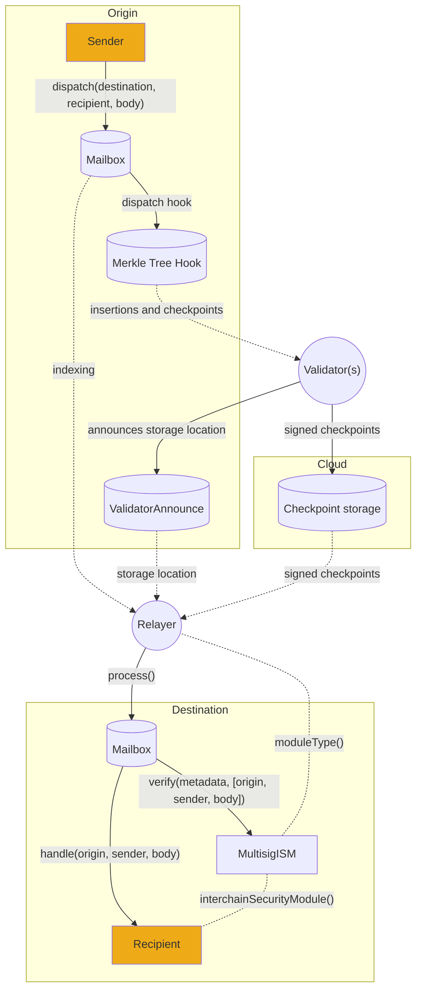

<Note>
  For an introduction on Validators in Hyperlane, you can check out the
  [Overview section](/docs/operate/overview-agents).
</Note>

As you follow this guide, you can run a Hyperlane validator on any of the existing [chains](https://github.com/hyperlane-xyz/hyperlane-registry/tree/main/chains) the protocol is live on. Hyperlane Validators are run on a per-origin-chain basis, and these instructions are written for a single chain.

## Requirements

- **Secure Signing Key**

  - Validators use this key to sign Merkle Tree Hook checkpoints. A compromised key can be used to sign fraudulent checkpoints.

  - The Validator supports AWS KMS, Google Cloud KMS, and local hex keys. See [checkpoint signer configuration](#checkpoint-signer-configuration) and [agent keys](/docs/operate/set-up-agent-keys).

- **Publicly Readable Storage**

  - Validators write their signatures off-chain to publicly accessible, highly available, storage, so that they can be aggregated by the [Relayer](/docs/protocol/agents/relayer).

  - Use Amazon S3 or Google Cloud Storage (GCS) in production. For local testing, write signatures to the filesystem. See [checkpoint syncer configuration](#checkpoint-syncer-configuration).

- **Machine Requirements**

  - Validators can build the Rust binary or use the Docker image. Give each instance a persistent, writable database directory. You can run instances in different regions for high availability.

- **RPC Node**

  - Validators use RPC to index Merkle Tree Hook insertions and read on-chain checkpoints. Use private endpoints that can serve historical insertion logs and state reads under the origin chain's finality policy.

  - Validators should configure multiple RPC URLs for redundancy and reliability. Different chains have different configurations—check the Configuration section for details.

<Note>
  Polygon mainnet uses the `finalized` block tag. Choose an RPC provider that supports it and serves the insertion history your Validator needs. See the [Polygon chain configuration](https://github.com/hyperlane-xyz/hyperlane-registry/blob/main/chains/polygon/metadata.yaml).
</Note>

## Guide

### Pre-Requisites

As a recap - before running a production Validator you need to have:

1. Created a key for your Validator to sign with, see the [Agent Keys](/docs/operate/set-up-agent-keys) documentation.
2. Set up storage for your Validator signatures. See [Amazon S3 setup](/docs/operate/validators/validator-signatures-aws) or [Google Cloud Storage setup](/docs/operate/validators/validator-signatures-gcs).

### Configuration

<Tip>
  Experienced operators may prefer to [deploy agents with
  Terraform](/docs/operate/guides/deploy-with-terraform) or a
  community-submitted [Ansible playbook](https://github.com/polkachu/hyperlane)
  instead. This process will automatically create agent keys, Validator buckets,
  permissions and any other auxiliary setup required to run a Validator cluster
  on AWS.
</Tip>

#### RPC Configuration

Hyperlane Validators can use **multiple RPC URLs** for reliability and redundancy. For production, configure independent private providers. For local testing with endpoints marked public, set `--allowPublicRpcs true`.

<Tabs>
  <Tab title="EVM Chains">
    Set [`customRpcUrls`](/docs/operate/config/config-reference#chains-<chain-name>-customrpcurls) to a comma-separated list of RPC URLs. This replaces the chain's `rpcUrls` list. With `majority` or `quorum`, the Validator uses these endpoints for checkpoint votes.
  </Tab>
  <Tab title="Cosmos Chains">
    Cosmos-based chains require both **RPC and gRPC endpoints** for proper operation.

    - **Configure multiple RPCs:** Use [`customRpcUrls`](/docs/operate/config/config-reference#chains-<chain-name>-customrpcurls).
    - **Configure gRPC endpoints:** Use [`customGrpcUrls`](/docs/operate/config/config-reference#chains-<chain-name>-customgrpcurls). The Validator uses gRPC endpoints for checkpoint votes.

  </Tab>
  <Tab title="SVM Chains">
    SVM-based chains support multiple RPC endpoints. Ordinary RPC calls can fail over to another endpoint if the current one fails or times out.

    - **Configure RPCs:** Use [`customRpcUrls`](/docs/operate/config/config-reference#chains-<chain-name>-customrpcurls).

    Checkpoint votes use the configured RPC endpoints.

    <Warning>
      **SVM Relayer Funding**: When relaying messages to SVM chains, make sure your Relayer key has sufficient funds on the destination chain. The Relayer performs view calls via simulations that require the sender to have funds for successful simulation, even for read operations. Without sufficient funds, you may encounter `No return data from InboxGetRecipientIsm instruction` errors.
    </Warning>

  </Tab>
  <Tab title="Tron">
    Configure the origin chain's RPC and wallet endpoints. The Validator uses `walletSolidityUrls` for checkpoint votes. Set `customWalletSolidityUrls` to override those URLs.
  </Tab>
</Tabs>

The origin chain's `rpcConsensusType` controls how the Validator verifies checkpoints before signing. With `majority` or `quorum`, the Validator compares each endpoint's reported root with its local tree at the reported leaf index. Providers can report different indices.

| Mode | Checkpoint verification |
| --- | --- |
| `majority` (default) | At least two thirds of the configured state-read endpoints must match local history, rounded up. With four endpoints, three must match. |
| `quorum` | At least half must match, rounded up. With four endpoints, two can authorize signing. |
| `single` or `fallback` | Uses the chain provider to verify the checkpoint without a vote across endpoints. |

Exact duplicate URLs count once. With `majority` or `quorum`, an unavailable endpoint keeps its place in the vote. Signing waits until enough endpoints agree. Indexing and other RPC calls can still use fallback. See the [Validator checkpoint consensus rules](https://github.com/hyperlane-xyz/hyperlane-monorepo/blob/agents-v4.0.0/rust/main/agents/validator/README.md#validator-checkpoint-consensus).

#### Validator WebSocket (optional)

The [Validator WebSocket](/docs/reference/explorer/validator-websocket) wakes your Validator on each new Merkle Tree Hook insertion so it can verify and sign checkpoints sooner. Keep all existing RPC endpoints so the Validator can independently check its locally computed Merkle root against the on-chain root before signing.

With [Validator v4.0.0](https://github.com/hyperlane-xyz/hyperlane-monorepo/releases/tag/agents-v4.0.0), add [`websocketUrl`](/docs/operate/config/config-reference#websocketurl) and keep your chain's configured `blocks.reorgPeriod`.

<CodeGroup>
```bash As Arg
--websocketUrl wss://explorer-api.hyperlane.xyz/validators
```

```bash As Env
export HYP_WEBSOCKETURL="wss://explorer-api.hyperlane.xyz/validators"
```

```json As Config
{
  "websocketUrl": "wss://explorer-api.hyperlane.xyz/validators"
}
```
</CodeGroup>

#### Configuration Settings

Replace `<origin>` with your origin chain name, such as `ethereum`.

| Parameter | Description |
| --- | --- |
| `--originChainName` | Name of the chain this Validator indexes and signs for. |
| `--db` | Persistent database directory. Defaults to `validator_db_<origin>` in the working directory. |
| `--chains.<origin>.customRpcUrls` | Comma-separated replacement for the origin chain's `rpcUrls`. For a custom chain config, include `rpcUrls` even when supplying an override. |
| `--chains.<origin>.rpcConsensusType` | Checkpoint verification mode. Defaults to `majority`. |
| `--chains.<origin>.blocks.reorgPeriod` | Confirmation depth or supported finality tag. Keep the origin chain's configured policy. |
| `--websocketUrl` | Optional live insertion feed. Use `wss://explorer-api.hyperlane.xyz/validators` without query parameters. |
| `--interval` | Polling and verification retry interval in seconds, including fractions down to `0.01`. Defaults to the chain's `index.interval`, then 2 seconds. |
| `--skipAnnounce` | Local testing only. Set to `true` to skip the on-chain storage announcement. Defaults to `false`. |
| `--maxSignConcurrency` | Maximum concurrent checkpoint signing operations per batch. Defaults to 50 and accepts 1 to 1,000. |

<Info>
  Your Validator takes both command line arguments and environment variables as
  configuration. Take a look at the [agent
  configuration](/docs/operate/config/agent-config) page and the [configuration
  reference](/docs/operate/config/config-reference) for a full list of
  configuration possibilities.
</Info>

You can also provide the path to additional configuration files as a comma separated list with the [`CONFIG_FILES` environment variable](/docs/operate/config/config-reference#config_files). If you choose to run in Docker, see the docker section of [agent configuration](/docs/operate/config/agent-config) for tips on mounting your config files into your Docker container.

### Setup-specific configuration

Choose a checkpoint signer and a storage backend for your environment.

#### Checkpoint signer configuration

For production, we strongly recommend an external, HSM-backed signing key. Use AWS KMS by default or Google Cloud KMS as an alternative.

<Tabs>
<Tab title="AWS KMS">

Create the signing key and grant the Validator access. [AWS KMS setup guide](/docs/operate/aws-kms)

| Argument             | Description                                                                                                                            |
| -------------------- | -------------------------------------------------------------------------------------------------------------------------------------- |
| `--validator.region` | The region of your AWS KMS key. For example: `us-east-1`.                                                                              |
| `--validator.type`   | Set to the `aws` literal.                                                                                                              |
| `--validator.id`     | The alias of your Validator's AWS KMS key, prefixed with `alias/`. For example: `alias/hyperlane-validator-signer-${originChainName}`. |

</Tab>
<Tab title="Google Cloud KMS">

Follow the [Google Cloud KMS setup guide](/docs/operate/google-cloud-kms) to create the key and grant the Validator access.

Set `--validator.type gcp` and `--validator.keyVersionName` to the full resource name of an `EC_SIGN_SECP256K1_SHA256` key version. Give the Validator's Application Default Credentials (ADC) permission to read the public key and sign with that version.

```text
projects/PROJECT_ID/locations/LOCATION/keyRings/KEY_RING/cryptoKeys/KEY/cryptoKeyVersions/VERSION
```

</Tab>
<Tab title="Hex Key">

| Argument                                | Description                                                                                                                                  |
| --------------------------------------- | -------------------------------------------------------------------------------------------------------------------------------------------- |
| `--validator.key` | A `0x`-prefixed, 32-byte hex key for checkpoint signing. You can supply it through `HYP_VALIDATOR_KEY`. |

</Tab>
</Tabs>

#### Transaction signer configuration

Fund the transaction signer with native tokens to send the initial on-chain announcement. On EVM and Tron, the checkpoint signer also sends the transaction if neither `chains.<origin>.signer` nor `defaultSigner` is configured. For local tests, `skipAnnounce` can skip the transaction.

<Tabs>
<Tab title="AWS KMS (EVM)">

| Argument                                    | Description                                                                                                                            |
| ------------------------------------------- | -------------------------------------------------------------------------------------------------------------------------------------- |
| `--chains.${originChainName}.signer.type`   | Set to the `aws` literal.                                                                                                              |
| `--chains.${originChainName}.signer.region` | The region of your AWS KMS key. For example: `us-east-1`.                                                                              |
| `--chains.${originChainName}.signer.id`     | The alias of your Validator's AWS KMS key, prefixed with `alias/`. For example: `alias/hyperlane-validator-signer-${originChainName}`. |

</Tab>
<Tab title="Google Cloud KMS (EVM or Tron)">

Set `chains.<origin>.signer.type` to `gcp` and `chains.<origin>.signer.keyVersionName` to the full Cloud KMS key version resource name. The signer uses Application Default Credentials.

</Tab>
<Tab title="Hex Key (EVM)">

Use these settings to configure a separate EVM transaction signer.

| Argument                                | Description                                                                                                                                  |
| --------------------------------------- | -------------------------------------------------------------------------------------------------------------------------------------------- |
| `--chains.${originChainName}.signer.key` | The `0x`-prefixed hex private key of the account that submits the on-chain announcement. |

</Tab>
<Tab title="Hex Key (Cosmos)">

| Argument                                    | Description                                                                                                                                      |
| ------------------------------------------- | ------------------------------------------------------------------------------------------------------------------------------------------------ |
| `--chains.${originChainName}.signer.type`   | Set to the `cosmosKey` literal.                                                                                                                  |
| `--chains.${originChainName}.signer.prefix` | Set to the prefix literal associated with the chain's address format. Example: `osmo`.                                                           |
| `--chains.${originChainName}.signer.key` | The `0x`-prefixed hex private key of the account that submits the on-chain announcement. |

</Tab>
<Tab title="Hex Key (SVM)">

Set `chains.<origin>.signer.key` to the funded Solana keypair's 32-byte seed as a `0x`-prefixed hex string.

</Tab>
</Tabs>

#### Checkpoint syncer configuration

Choose storage independently of your signing key. Amazon S3 is the default production setup in this guide. Google Cloud Storage is also supported.

<Tabs>
<Tab title="Amazon S3">

Create the bucket and grant write access to the Validator and public read access to Relayers. [Amazon S3 setup guide](/docs/operate/validators/validator-signatures-aws)

| Argument                    | Description                                                           |
| --------------------------- | --------------------------------------------------------------------- |
| `--checkpointSyncer.type`   | Set to `s3`.                                                          |
| `--checkpointSyncer.bucket` | The AWS S3 bucket name.                                               |
| `--checkpointSyncer.region` | The region of your AWS S3 bucket. For example: `us-east-1`.           |
| `--checkpointSyncer.folder` | An optional folder for this Validator's checkpoints. |

</Tab>
<Tab title="Google Cloud Storage">

Create the bucket and configure its IAM bindings. [Google Cloud Storage setup guide](/docs/operate/validators/validator-signatures-gcs)

Set `--checkpointSyncer.type gcs` and `--checkpointSyncer.bucket` to the bucket name. If you set `--checkpointSyncer.folder`, use a single segment such as `ethereum-validator-1`. Nested paths prevent the Relayer from parsing the announced storage location.

Grant the Validator read and write access to checkpoint objects and allow unauthenticated reads for Relayers. For workload credentials such as GKE Workload Identity, set `--checkpointSyncer.useApplicationDefault true`. For a service account key file, leave this setting off and set `--checkpointSyncer.serviceAccountKey` to the path inside the Validator process.

</Tab>
<Tab title="Local Setup">

| Argument                  | Description                                                                                                                                                                                                                                                |
| ------------------------- | ---------------------------------------------------------------------------------------------------------------------------------------------------------------------------------------------------------------------------------------------------------- |
| `--checkpointSyncer.type` | Set to `localStorage`.                                                                                                                                                                                                                                     |
| `--checkpointSyncer.path` | The path to your local directory where Validator signatures will be written. For example, use `--checkpointSyncer.path /tmp/hyperlane-validator-signatures-ethereum`. |

Use `--skipAnnounce true` for local tests that only need checkpoint signing. The Validator still writes the signed announcement and checkpoints to disk. Local storage requires no cloud upload.

<Warning>
  For end-to-end tests with a Relayer, leave `skipAnnounce` at its default so the Relayer can discover the storage location. Make the directory available to the Relayer at the same absolute path and configure it with `--allowLocalCheckpointSyncers true`.
</Warning>

</Tab>
</Tabs>

## Start Validating

### Setup

The recommended installation method for a production environment is using a Docker image.

<Tabs>
<Tab title="Docker image">

First download the docker image:

```bash
docker pull --platform linux/amd64 ghcr.io/hyperlane-xyz/hyperlane-agent:agents-v4.0.0
```

</Tab>
<Tab title="Building from source">

**Clone and setup**

First, clone the Hyperlane monorepo:

```sh
git clone --branch agents-v4.0.0 --depth 1 https://github.com/hyperlane-xyz/hyperlane-monorepo.git
```

Install `rustup` so Cargo can select the release's pinned Rust toolchain. On Apple Silicon you may also need Rosetta 2. [Rust workspace setup for v4.0.0](https://github.com/hyperlane-xyz/hyperlane-monorepo/blob/agents-v4.0.0/rust/README.md#setup)

```sh
# install rustup
curl --proto '=https' --tlsv1.2 -sSf https://sh.rustup.rs | sh

# (apple silicon only) install rosetta 2
softwareupdate --install-rosetta --agree-to-license
```

Build the Validator:

```sh
cd hyperlane-monorepo/rust/main
cargo build --release --bin validator
```

</Tab>
</Tabs>

### Running the binary

The examples below use AWS KMS and S3 on Ethereum. Replace the key alias, bucket, and regions with your own. Set `ETHEREUM_RPC_URLS` to a comma-separated list of your private RPC endpoints. The agent loads contract addresses and finality settings from its bundled chain configuration.

If you use AWS environment credentials, export the following variables before starting the Validator. AWS KMS also supports ECS task roles and EKS web identity.

| Environment variable    | Description                                             |
| ----------------------- | ------------------------------------------------------- |
| `AWS_ACCESS_KEY_ID`     | The access key ID of your Validator's AWS IAM user.     |
| `AWS_SECRET_ACCESS_KEY` | The AWS secret access key. |
| `AWS_SESSION_TOKEN` | The session token, when using temporary credentials. |

See [AWS KMS setup](/docs/operate/aws-kms) for key and IAM configuration.

<Tabs>
<Tab title="Using Docker">

Start the Validator with a persistent database volume.

```sh
docker run --platform linux/amd64 \
  --mount type=volume,source=hyperlane-validator-ethereum,target=/data \
  -e AWS_ACCESS_KEY_ID -e AWS_SECRET_ACCESS_KEY -e AWS_SESSION_TOKEN \
  ghcr.io/hyperlane-xyz/hyperlane-agent:agents-v4.0.0 \
  ./validator \
  --db /data/validator_db \
  --originChainName ethereum \
  --chains.ethereum.customRpcUrls "$ETHEREUM_RPC_URLS" \
  --validator.type aws \
  --validator.id alias/hyperlane-validator \
  --validator.region us-east-1 \
  --checkpointSyncer.type s3 \
  --checkpointSyncer.bucket your-validator-signatures \
  --checkpointSyncer.region us-east-1 \
  --checkpointSyncer.folder ethereum
```

</Tab>
<Tab title="Building from source">

Run the built binary from `hyperlane-monorepo/rust/main` so it can find the bundled chain configuration.

```sh
./target/release/validator \
  --db ./validator_db_ethereum \
  --originChainName ethereum \
  --chains.ethereum.customRpcUrls "$ETHEREUM_RPC_URLS" \
  --validator.type aws \
  --validator.id alias/hyperlane-validator \
  --validator.region us-east-1 \
  --checkpointSyncer.type s3 \
  --checkpointSyncer.bucket your-validator-signatures \
  --checkpointSyncer.region us-east-1 \
  --checkpointSyncer.folder ethereum
```

</Tab>
</Tabs>

### Announcing your Validator

The [Relayer](/docs/operate/relayer/run-relayer) needs to know where to find your Validator's signatures. Your Validator will automatically attempt to announce itself by writing to the `ValidatorAnnounce` contract on the chain that you're validating.

The origin-chain transaction signer needs enough native tokens to pay for gas. The Validator writes a signed copy of the announcement to the checkpoint syncer before sending the transaction.

If your Validator has not yet announced itself, and does not have enough tokens to pay for gas, it will log a message specifying how many tokens are needed.

### Success!

With the default `majority` policy, look for `Initial consensus backfill verified` in the logs after the chain has a Merkle Tree Hook insertion. Then look for `Initial historical checkpoint publication complete` to confirm that signed checkpoints have reached storage. For local storage, inspect `index.json` and the corresponding `<index>_with_id.json`. See [Validator monitoring](/docs/operate/validators/monitoring-alerting) for ongoing checks.

## Running Multiple Validators

We encourage folks to validate on as many chains as they are interested in supporting. This section provides an overview of the considerations and instructions to set up multiple validators.

Multiple instances can improve availability. To increase signer redundancy on a given origin, run distinct signing keys that the destination ISM is configured to accept.

### Running Multiple Validators: Key Considerations

- **Reusing Keys**: You can reuse a signing key across origins. Use distinct keys for Validators that should count as separate signers on the same origin.
- **Shared AWS Account**: The same AWS account can be used by multiple validators.
- **Using a Shared Bucket**. Give each origin and signer its own folder in S3 or GCS (for example, `--checkpointSyncer.folder ethereum-validator-1`).

### Additional Steps for Multiple Validators

#### 1. Create an Agent Configuration

- Generate an agent [configuration](#configuration) file for each validator, specifying the chains they will validate and the corresponding RPC URLs.
- Ensure that each configuration file points to the correct signing key and checkpoint storage location.

#### 2. Run Each Validator

- Ensure each Validator is assigned a unique database path (e.g., `--db /hyperlane_db_validator1`).
- When processes share a network namespace, assign each Validator a unique metrics port (for example, `--metricsPort 9090` and `--metricsPort 9091`).
- If running multiple validators on the same machine, allocate sufficient system resources (CPU, memory, and storage).
- Ensure logs are directed to separate files or services for easier debugging and monitoring.
- If using Docker, assign unique container names and network configurations to avoid conflicts.

By following these additional steps, you can efficiently manage multiple Hyperlane Validators.

## Design Reference


