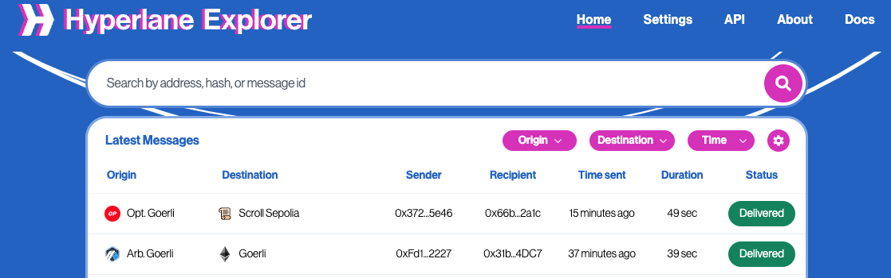

Messages to/from [core chains](/docs/reference/domains) will be searchable by transaction hash, message ID, or sender/recipient address. For other chains, the explorer can be configured to search for messages by providing it a chain config.

### Access Explorer data from your application

The Explorer provides public, read-only APIs for indexed Hyperlane activity:

- [GraphQL API](./graphql-api): look up messages and delivery status, search by transaction or address, paginate history, count messages, and discover indexed domains.
- [WebSocket API](./websocket-api): receive live message and delivery updates, including optional zero-confirmation observations and rollback notifications.

Start with GraphQL to load your data, then add a WebSocket connection for ongoing updates. API coverage depends on the chains indexed by the Explorer; adding a custom chain to the UI does not add it to the public index.

### Searching for messages

The [Hyperlane Explorer](https://explorer.hyperlane.xyz/) supports searching for messages using any of the following values:

- Hash of the transaction that initiated the message (origin tx)
- Hash of the transaction that delivered message (destination tx)
- Address of the account that sent the origin transaction
- Address of the account that sent the destination transaction
- Address of the message sender
- Address of the message recipient
- ID of the message

To search, enter your query into the top search bar. You can use the Origin Chain, Destination Chain, and Time filter options to narrow down your search.

<Info>
  Note, by default the explorer will only find message on [core Hyperlane chains](/docs/reference/domains).

To view messages sent to and/or from other chains, see [Configuring PI Chains](/docs/reference/explorer/configuring-pi-chains).

</Info>

### Permissionless Interoperability[​](#permissionless-interoperability "Direct link to Permissionless Interoperability")

The explorer can be configured to search for messages on any chain with a Hyperlane deployment. See [configuring PI Chains](/docs/reference/explorer/configuring-pi-chains) for details.

### Debugging Messages[​](#debugging-messages "Direct link to Debugging Messages")

If you're trying to debug a problem with message delivery, the [explorer debugging](/docs/reference/explorer/explorer-debugging) page has useful tips.
